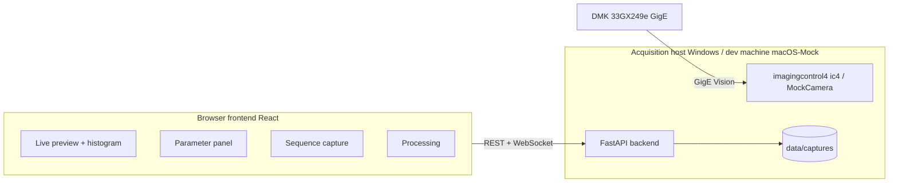

# Static AstroPhoto

**Static AstroPhoto** is an acquisition and processing system (Diffraction Stacking) for
**static LEED / RHEED electron diffraction spots**.
It borrows the deep-sky astrophotography workflow — **Bias / Dark / Flat calibration + multi-frame sigma stacking** —
to improve SNR and dynamic range of faint diffraction spots. The target is static, so **no equatorial mount,
guiding, or de-rotation** is needed.

> This is the development documentation (migrated from the repo-root `README.en.md` into `docs/`). User-facing docs: [../README.en.md](../README.en.md). 中文开发文档：[DEVELOPMENT.md](DEVELOPMENT.md)

---

## System Overview

- **Camera**: The Imaging Source **DMK 33GX249e** (mono 12-bit GigE industrial CMOS, Sony IMX249,
  1920×1200 @ 48 fps, exposure 30 µs–30 s, gain 0–48 dB)
- **Backend**: FastAPI (Python 3.10+), runs on a **Windows acquisition host** (ic4 SDK).
  A **Mock camera** mode is provided so the full workflow can be developed on macOS/Linux without hardware.
- **Frontend**: a **web SPA** built with React 18 + TypeScript + Vite + Ant Design
  (LAN browser access, no client installation required)
- **Data path**: `12-Bit Packed transport → uint16 in memory → 16-bit FITS on disk`;
  live preview uses 8-bit grayscale JPEG only and never touches acquired data
- **Processing pipeline**: master calibration frames (sigma-clipped mean) →
  per-frame calibration `(light − dark) / flat_norm` → optional FFT phase-correlation drift registration →
  sigma-clipped stacking (float32 result) → grayscale stretch preview

## Features

- Live preview: WebSocket JPEG stream + per-frame stats (min/max/mean/std/saturated-pct/256-bin histogram)
- Parameter panel: exposure / gain / black level / ROI / mirror / trigger applied instantly,
  with the camera's actual value reported back
- Four-phase sequence capture: `BIAS → DARK → FLAT → LIGHT` with guided prompts for each phase;
  **before LIGHT the operator must manually confirm parameters against the live histogram**
  (center-spot overexposure is judged by the operator)
- Bad-frame exclusion: processing accepts per-filename `exclude` lists, enforced end-to-end
- Processing jobs: calibrate / stack / stretch run as background jobs with WebSocket progress updates
- Storage: 16-bit FITS with full acquisition metadata + PNG thumbnails + session `meta.json`
- 12-bit friendly QC: saturation ratio, temperature, black-level clipping tracked for every frame

## Architecture



## Repository Layout (repository-root view)

```
.
├── backend/                # FastAPI backend
│   ├── app/
│   │   ├── main.py         # REST + /ws/live + /ws/events + static frontend hosting
│   │   ├── camera.py       # MockCamera / IC4Camera + device service
│   │   ├── capture.py      # four-phase capture state machine, FITS/thumbnail writer
│   │   ├── process.py      # calibrate / stack / stretch background jobs
│   │   ├── sessions.py     # session metadata
│   │   └── util.py         # stats, auto contrast, path helpers
│   ├── requirements.txt
│   └── README.md           # backend details incl. Windows real-camera setup
├── frontend/               # React SPA
│   └── src/
│       ├── api/            # axios wrapper, WS clients, types, state machine
│       └── pages/          # Connect / Live / Capture / Processing / Settings
├── scripts/
│   ├── install.sh          # one-command installer (macOS / Linux / WSL, idempotent)
│   ├── install.ps1         # one-command installer (Windows PowerShell; -WithCamera adds real-camera deps)
│   └── backend_smoke.py    # end-to-end backend self-test (Mock full workflow)
├── docs/
│   ├── architecture.md     # architecture design v0.3
│   ├── api.md              # frontend-backend API contract v1.4
│   └── reviews/            # independent review & acceptance reports
└── data/                   # runtime data (git-ignored)
    ├── snapshots/
    └── captures/<timestamp>_<name>/{bias,dark,flat,light,masters,calibrated,results}
```

## Quick Start

> The commands below are run from the repository root (this file lives in `docs/`; from `docs/` the scripts are at `../scripts/` and the data directory is `../data/`).

### Prerequisites

| Use case | Requirement |
|---|---|
| Installer | Python ≥ 3.10 (3.12 / 3.11 preferred, must be able to create a venv) + Node.js ≥ 20 with npm |
| Backend (real camera) | Windows 10/11 + Python 3.10+ (3.12 recommended) + ic4 driver |
| Backend (development) | macOS / Linux / WSL + Python 3.12 (Mock camera is used automatically) |
| Frontend | Node.js ≥ 20 (22+ recommended) with npm (dependencies are installed and built by the installer) |
| Camera | DMK 33GX249e (optional — every feature works with the Mock camera) |

### 1. Clone

```bash
git clone <your-repo-url> static-astrophoto
cd static-astrophoto
```

### 2. One-command install (right after cloning)

macOS / Linux / WSL:

```bash
./scripts/install.sh
```

Windows PowerShell (Mock mode; add `-WithCamera` to install the imagingcontrol4 bindings):

```powershell
.\scripts\install.ps1
.\scripts\install.ps1 -WithCamera   # real-camera mode
```

The installer is idempotent and safe to re-run. It will:

1. auto-select Python (3.12 / 3.11 preferred, ≥ 3.10 required), create `backend/.venv`,
   upgrade pip, and install `backend/requirements.txt` (an existing usable venv is reused without reinstalling);
2. detect Node.js / npm, run `npm install` (with cache-repair hints on cache errors) and `npm run build` in `frontend/`;
3. create the `data/snapshots` and `data/captures` directories under the repository root.

> Optional frontend development: `cd frontend && npm run dev` starts Vite (http://localhost:5173),
> proxying `/api` and `/ws` to `http://localhost:8000`.

### 3. Start

macOS / Linux / WSL (Mock camera):

```bash
cd backend
.venv/bin/python -m uvicorn app.main:app --host 0.0.0.0 --port 8000
```

Windows:

```powershell
cd backend
.venv\Scripts\python -m uvicorn app.main:app --host 0.0.0.0 --port 8000
```

Open **http://localhost:8000** in your browser (the installer has already built the frontend;
FastAPI serves `frontend/dist/` directly).

> Real-camera prerequisites: install The Imaging Source ic4 driver and bind the GigE NIC;
> enable Jumbo Frames (9000 MTU) where possible. See [../backend/README.md](../backend/README.md).

### 4. Workflow

1. **Connect**: on `/connect`, choose `mock-1` (development) or `ic4-<serial>` (real camera) and open it
2. **Live view**: on `/live`, inspect the image and histogram, adjust exposure / gain / black level / ROI etc.
3. **Capture**: on `/capture`, create a plan (or click the default template) and follow the prompts:
   BIAS (lens cap on) → DARK (cap still on) → FLAT (defocused beam / uniform illumination) →
   LIGHT (confirm parameters manually, then start)
4. **Process**: on `/processing`, pick a session → exclude bad frames → calibrate → stack → stretch preview and download results

## 12-bit Data Path

The camera ADC is 12-bit (0–4095). The system therefore:

- **Transport**: 12-Bit Packed (1.5 B/px) — 33% less GigE bandwidth than 16-bit, higher max frame rate, zero precision loss
- **Memory/compute**: after unpacking to uint16, performance is identical to 16-bit; median / sigma-clip run in float anyway
- **Storage**: 16-bit FITS (data in the lower 12 bits) for direct compatibility with astropy / ImageJ / DS9
- **Stack result**: float32 FITS (BITPIX=-32) to preserve fractional precision of frame averaging
- **Preview**: 8-bit grayscale auto contrast (1%–99% percentile); mono camera — no debayer / color LUT

## API & Contract

- Uniform response envelope: `{ "ok": bool, "data": any, "error": string|null }`
- REST: `/api/health`, `/api/devices`, `/api/device/*`, `/api/properties`, `/api/live/*`,
  `/api/snapshot`, `/api/capture/*`, `/api/sessions/*`, `/api/files/*`, `/api/process/*`
- WebSocket: `/ws/live` (text stats → binary JPEG pairs), `/ws/events` (capture / job progress)
- Swagger UI: `http://<host>:8000/docs`
- Full contract: [api.md](api.md)

## Testing

```bash
# Backend end-to-end self-test (exit code 0 = pass)
cd backend && .venv/bin/python ../scripts/backend_smoke.py   # exit code 0 = all pass

# Frontend build & lint
cd frontend && npm run build && npm run lint
```

Independent reviews and acceptance runs are recorded in `reviews/`:

- Backend review: smoke all pass + edge-case suite (error envelope, state machine, path traversal, SPA fallback) all green
- Frontend review: 8/8 contract items PASS, build 0 errors
- Final integration acceptance: 62/62 PASS, P0=0 / P1=0 (full Mock workflow + performance + security regression)

## Mock Camera

Without hardware the backend always provides `mock-1`:

- Synthetic static LEED/RHEED pattern: regular grid of Gaussian spots + bright 00 spot + phosphor-screen glow
- Noise model: read noise + Poisson noise (hybrid implementation) + hot pixels;
  exposure / gain / black_level all take effect
- Default ROI 1024×768 (up to 1920×1200); ~22–24 fps at full ROI in the diffraction scene
- Slowly drifting temperature and optional sub-pixel pattern drift (to exercise registration)
- Special properties: `mock_scene` (diffraction / uniform / dark), `mock_drift`

## Known Limitations

- The `IC4Camera` real-device path has not yet been verified on Windows; first bring-up may need
  minor adjustments to property enumeration
- The camera has no TEC cooling: darks should be taken close in time/temperature to the lights
  (per-frame temperature is recorded)
- Center-spot overexposure is intentionally not handled automatically; the operator confirms
  parameters against the histogram before LIGHT
- macOS supports Mock mode only; real-camera acquisition must run on a Windows host

## Documentation

- [architecture.md](architecture.md) — architecture design & key decisions
- [api.md](api.md) — frontend-backend API contract v1.4
- [reviews/](reviews/) — review & acceptance reports
- [../backend/README.md](../backend/README.md) — backend and Windows real-camera deployment details
- [../frontend/README.md](../frontend/README.md) — frontend development notes

## License

TBD
