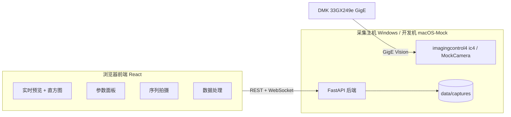

# Static AstroPhoto

**Static AstroPhoto** 是面向 **LEED / RHEED 静态电子衍射点** 的采集与处理系统
（Diffraction Stacking）。
借用深空摄影的 **Bias / Dark / Flat 标定 + 多帧 Sigma 叠加** 方法提升弱衍射点的信噪比与动态范围，
目标静止，因此**无需赤道仪、导星、去旋转**。

> 本文件为开发文档（由仓库根 `README.md` 迁移至 `docs/`）。用户文档见 [../README.md](../README.md)；英文开发文档见 [DEVELOPMENT.en.md](DEVELOPMENT.en.md)。

---

## 系统组成

- **相机**：The Imaging Source **DMK 33GX249e**（单色 12-bit GigE 工业 CMOS，Sony IMX249，1920×1200 @ 48 fps，曝光 30 µs–30 s，增益 0–48 dB）
- **后端**：FastAPI（Python 3.10+），运行在 **Windows 采集主机**（ic4 SDK）；无真机时提供 **Mock 相机** 模式，macOS/Linux 可完整开发调试
- **前端**：React 18 + TypeScript + Vite + Ant Design 的 **Web 单页应用**（局域网浏览器访问，无需安装客户端）
- **数据链**：`12-Bit Packed 传输 → uint16 内存 → 16-bit FITS 落盘`，预览仅用 8-bit 灰阶 JPEG，不污染采集数据
- **处理管线**：master 校准帧（sigma-clipped mean）→ 逐帧标定 `(light − dark) / flat_norm` → 可选 FFT 相位相关漂移配准 → sigma-clipped 叠加（float32 结果）→ 灰度拉伸预览

## 特性

- 实时预览：WebSocket 推送 JPEG 帧 + 逐帧统计（min/max/mean/std/饱和比例/256-bin 直方图）
- 参数面板：曝光 / 增益 / 黑电平 / 自动曝光开关 / 自动增益开关 / 采集区域（Width × Height）/ 镜像 / 触发等即调即生效，显示相机实际返回值
- 四相位序列拍摄：`BIAS → DARK → FLAT → LIGHT`，每相位有引导提示；
  **FLAT 与 LIGHT 前强制人工确认**（BIAS / DARK 自动继续；FLAT 检查均匀照明，LIGHT 对照实时直方图；中心束过曝程度由人工判断）
- 坏帧排除：处理时按文件名 `exclude`，前后端真实生效
- 处理任务：calibrate / stack / stretch 后台 job 化，进度经 WebSocket 推送
- 数据落盘：16-bit FITS（含完整拍摄元数据）+ PNG 缩略图 + 会话 `meta.json`
- 12-bit 友好：饱和比例、温度、黑电平裁切等 QC 指标全程记录

## 架构



## 目录结构（仓库根目录视角）

```
.
├── backend/                # FastAPI 后端
│   ├── app/
│   │   ├── main.py         # REST + /ws/live + /ws/events + 前端静态托管
│   │   ├── camera.py       # MockCamera / IC4Camera + 设备服务
│   │   ├── capture.py      # 四相位拍摄状态机、FITS/缩略图落盘
│   │   ├── process.py      # calibrate / stack / stretch 后台任务
│   │   ├── sessions.py     # session 元数据
│   │   └── util.py         # 统计、自动对比度、路径工具
│   ├── requirements.txt
│   └── README.md           # 后端部署细节（Windows 真机步骤）
├── frontend/               # React SPA
│   └── src/
│       ├── api/            # axios 封装、WS 客户端、类型、状态机
│       └── pages/          # Connect / Live / Capture / Processing / Settings
├── scripts/
│   ├── install.sh          # 一键安装（macOS / Linux / WSL，幂等）
│   ├── install.ps1         # 一键安装（Windows PowerShell；-WithCamera 装真机依赖）
│   └── backend_smoke.py    # 后端端到端自测（Mock 全流程）
├── docs/
│   ├── architecture.md     # 架构设计 v0.3
│   ├── api.md              # 前后端 API 契约 v1.4
│   └── reviews/            # 独立评审与集成验收报告
└── data/                   # 运行时数据（git 忽略）
    ├── snapshots/
    └── captures/<时间戳>_<名称>/{bias,dark,flat,light,masters,calibrated,results}
```

## 快速开始

> 以下命令均在仓库根目录执行（本文件位于 `docs/`；若从 `docs/` 执行，脚本路径为 `../scripts/`，数据目录为 `../data/`）。

### 前置要求

| 用途 | 要求 |
|---|---|
| 安装脚本 | Python ≥ 3.10（优先 3.12 / 3.11，需能创建 venv）+ Node.js ≥ 20 与 npm |
| 后端（真机） | Windows 10/11 + Python 3.10+（推荐 3.12）+ ic4 驱动 |
| 后端（开发） | macOS / Linux / WSL + Python 3.12（自动使用 Mock 相机） |
| 前端 | Node.js ≥ 20（推荐 22+）与 npm（由安装脚本自动安装依赖并构建） |
| 相机 | DMK 33GX249e（可选；没有也能用 Mock 跑通全部功能） |

### 1. 克隆

```bash
git clone <your-repo-url> static-astrophoto
cd static-astrophoto
```

### 2. 一键安装（克隆后直接执行）

macOS / Linux / WSL：

```bash
./scripts/install.sh
```

Windows PowerShell（Mock 模式；真机加 `-WithCamera` 额外安装 imagingcontrol4）：

```powershell
.\scripts\install.ps1
.\scripts\install.ps1 -WithCamera   # 真机模式
```

脚本幂等，可安全重复执行。它会：

1. 自动选择 Python（优先 3.12 / 3.11，要求 ≥ 3.10）并创建 `backend/.venv`，
   升级 pip 后安装 `backend/requirements.txt`（已有可用 venv 时直接复用，不重复装依赖）；
2. 检测 Node.js / npm，在 `frontend/` 执行 `npm install`（cache 异常时输出修复命令）与 `npm run build`；
3. 创建仓库根目录下的 `data/snapshots` 与 `data/captures` 目录。

> 前端联调（可选）：`cd frontend && npm run dev` 启动 Vite（http://localhost:5173），
> 代理 `/api`、`/ws` 到 `http://localhost:8000`。

### 3. 启动

macOS / Linux / WSL（Mock 相机）：

```bash
cd backend
.venv/bin/python -m uvicorn app.main:app --host 0.0.0.0 --port 8000
```

Windows：

```powershell
cd backend
.venv\Scripts\python -m uvicorn app.main:app --host 0.0.0.0 --port 8000
```

浏览器打开 **http://localhost:8000**（安装脚本已构建前端，FastAPI 直接托管 `frontend/dist/`）。

> 真机前置：安装 The Imaging Source 的 ic4 驱动并绑定 GigE 网卡，建议开启 Jumbo Frame（9000 MTU）；
> 详见 [../backend/README.md](../backend/README.md)。

### 4. 使用流程

1. **连接**：`/connect` 页选择 `mock-1`（开发）或 `ic4-<serial>`（真机）并打开
2. **实时预览**：`/live` 页看画面与直方图，调曝光/增益/黑电平/采集区域/自动曝光/自动增益等参数
3. **序列拍摄**：`/capture` 页创建计划（或点“默认衍射套装”），按提示依次完成
   BIAS（盖镜头盖）→ DARK（保持盖盖）→ FLAT（束流散焦均匀照明，人工确认后开始）→ LIGHT（人工确认参数后开始）
4. **数据处理**：`/processing` 页选 session → 排除坏帧 → calibrate → stack → stretch 预览并下载结果

## 12-bit 数据链说明

相机 ADC 为 12-bit（0–4095）。系统选择：

- **传输**：12-Bit Packed（1.5 B/px）——比 16-bit 省 33% GigE 带宽，全分辨率帧率上限更高，零精度损失
- **内存/计算**：解包为 uint16 后与 16-bit 计算速度完全相同；median / sigma-clip 等均以 float 计算
- **落盘**：16-bit FITS（数据在低 12 位），保证 astropy / ImageJ / DS9 直接兼容
- **叠加结果**：float32 FITS（BITPIX=-32），保留多帧平均的小数精度
- **预览**：8-bit 灰阶自动对比度（1%–99% 分位），单色相机无 debayer / 彩色 LUT

## API 与契约

- 统一响应结构：`{ "ok": bool, "data": any, "error": string|null }`
- REST：`/api/health`、`/api/devices`、`/api/device/*`、`/api/properties`、`/api/live/*`、
  `/api/snapshot`、`/api/capture/*`、`/api/sessions/*`、`/api/files/*`、`/api/process/*`
- WebSocket：`/ws/live`（文本统计 → 二进制 JPEG 成对推送）、`/ws/events`（capture / job 进度）
- Swagger UI：启动后访问 `http://<host>:8000/docs`
- 完整契约见 [api.md](api.md)

## 测试

```bash
# 后端端到端自测（退出码 0 = 通过）
cd backend && .venv/bin/python ../scripts/backend_smoke.py   # 退出码 0 = 全部通过

# 前端构建与 lint
cd frontend && npm run build && npm run lint
```

已执行的独立评审与验收（见 `reviews/`）：

- 后端独立评审：smoke 全部通过 + 补测（错误包裹、状态机、路径穿越、SPA fallback 等）全绿
- 前端独立评审：契约对照 8/8 PASS，构建 0 error
- 最终集成验收：62/62 PASS，P0=0 / P1=0（Mock 全流程 + 性能 + 安全回归）

## Mock 相机

无真机时后端自动提供 `mock-1`：

- 合成静态 LEED/RHEED 点阵：规则格点高斯斑 + 亮 00 斑 + 荧光屏背景辉光
- 噪声模型：读出噪声 + 泊松噪声（混合实现）+ 热像素；exposure / gain / black_level 均生效
- 默认采集区域 1024×768（Width 480–1920/step 16，Height 4–1200/step 4）；满幅衍射场景约 22–24 fps
- 温度缓慢漂移、可选亚像素漂移（用于配准功能演示）
- 特殊属性：`mock_scene`（diffraction / uniform / dark）、`mock_drift`

## 已知限制

- `IC4Camera` 真机路径尚未在 Windows 上实测，首次联调可能需微调属性枚举
- 相机无 TEC 制冷：Dark 需与 Light 在邻近时间、相近温度下拍摄（系统记录每帧温度）
- 中心束过曝不自动处理：按设计由人工在 FLAT / LIGHT 前确认参数（LIGHT 对照直方图）
- macOS 只能运行 Mock 模式；真机采集必须部署在 Windows 主机

## 文档

- [architecture.md](architecture.md) — 架构设计与关键决策
- [api.md](api.md) — 前后端 API 契约 v1.4
- [reviews/](reviews/) — 评审与验收报告
- [../backend/README.md](../backend/README.md) — 后端与 Windows 真机部署细节
- [../frontend/README.md](../frontend/README.md) — 前端开发说明

## License

待定（TBD）
