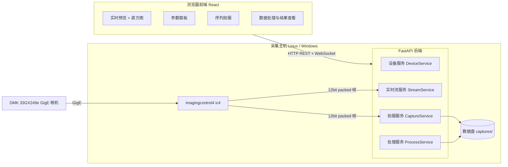

# 电子衍射图像采集与处理系统 — 架构设计 v0.3

> 目标：为 **LEED / RHEED 衍射屏上的静态电子衍射点**构建一套
> 「实时预览 + 参数控制 + 序列拍摄 + 天文式标定叠加」的 Web 系统。
> 方法借用深空摄影的短曝光多帧 + Bias/Dark/Flat 标定 + Sigma 叠加，
> **不含**赤道仪、导星、去旋转等地球自转相关环节。

---

## 1. 需求摘要

1. **前端**：
   - 实时显示 CMOS 相机影像（Live 预览）
   - 显示/调节相机控制参数（曝光、增益、黑电平、自动曝光/自动增益、采集区域 Width/Height、binning、触发等）
   - 序列拍摄界面（亮场 / 暗场 / 平场 / 偏置场）
   - 数据处理界面（标定、叠加、拉伸显示、结果导出）
2. **后端**：
   - **拍摄模块**：相机管理、实时流、参数读写、序列自动采集、FITS/TIFF 存储
   - **数据处理模块**：master 校准帧生成、逐帧标定、可选漂移配准、
     sigma-clipped 叠加、asinh 拉伸、质量统计

---

## 2. 总体架构



- **前端**：浏览器单页应用（SPA），通过 REST 控制、WebSocket 收视频流与任务进度。
- **后端**：FastAPI 单体服务，内置 4 个子服务；相机访问统一走 `imagingcontrol4`（ic4）。
- **关键约束**：ic4 只支持 **Windows / Linux**，不支持 macOS。
  因此相机采集后端必须运行在 Windows 采集主机上；Web 前端在**局域网内**
  任意设备的浏览器打开（已确认纯 Web、仅局域网）。

---

## 3. 部署前提

| 项目 | 要求 | 说明 |
|---|---|---|
| 采集主机 OS | **Windows（已确认）** | ic4 官方支持；采集服务部署在 Windows 采集主机 |
| 前端 | 纯 Web 网页（浏览器），仅局域网使用（已确认） | 任意设备浏览器访问，无需安装客户端 |
| 网络 | 千兆网口直连相机（或同一交换机） | 开启 Jumbo Frame（巨型帧，如 9000 MTU）提升吞吐 |
| 相机供电 | GigE 需要 PoE 或 12V 电源 | DMK 33GX249e 无制冷，注意环境温度稳定 |
| Python | 3.10+ | 后端语言 |
| 相机 SDK | `pip install imagingcontrol4` + ic4 驱动 | 驱动安装见 TIS 官方文档 |

**Plan B（Windows）**：如 ic4 驱动与系统兼容性有问题，回退到 TIS 官方
`tiscamera`（GStreamer + PyGObject），接口层封装成相同抽象，上层不变。

---

## 4. 技术选型

| 层 | 选型 | 理由 |
|---|---|---|
| 前端框架 | React 18 + TypeScript + Vite | 生态成熟，适合工控/科研面板 |
| UI 组件 | Ant Design 5 | 表单/表格/进度条/滑块齐全 |
| 前端状态 | React Query + Zustand | 服务端状态与本地 UI 状态分离 |
| 图表 | Recharts | 直方图/曲线展示 |
| 后端 | FastAPI + Uvicorn | 异步 + WebSocket 原生支持 |
| 相机 SDK | imagingcontrol4（ic4 Python） | TIS 官方，DMK 33GX249e 原生支持 |
| 图像处理 | numpy / scipy / astropy / scikit-image | sigma clip、FITS、相位相关配准 |
| 图像编码 | OpenCV（cv2.imencode） | 预览 JPEG 编码 |
| 存储 | FITS（主，16-bit 容器存 12-bit 数据）+ TIFF/PNG 可选 | FITS 头部保存完整拍摄元数据 |

### 4.1 位深分析：12-bit 与 16-bit 在传输/处理上的差距

相机原生的位深与输出格式：

- 传感器/ADC：**12 bit**（0–4095）
- 相机可输出：8-Bit Mono、**12-Bit Packed Mono**（1.5 字节/像素）、16-Bit Mono（2 字节/像素，高 4 位补零）

**① 传输（GigE 带宽是瓶颈）**

全分辨率 1920 × 1200 = 2,304,000 像素，千兆网实际可用 ≈ 115–125 MB/s：

| 输出格式 | 单帧大小 | 48 fps 所需带宽 | 带宽约束下的帧率上限 | 结论 |
|---|---|---|---|---|
| 8-bit | 2.30 MB | 110.6 MB/s | ≈48 fps（贴着上限） | 精度损失，不用 |
| **12-Bit Packed** | 3.46 MB | 165.9 MB/s | **≈36 fps** | ✅ 原生、无精度损失、带宽最省 |
| 16-bit | 4.61 MB | 221.2 MB/s | ≈27 fps | 传输量 +33%，多传的全是补零位 |

> 相机标称 48 fps 是 8-bit 下的上限；12-bit 模式受 GigE 带宽限制约 36 fps。
> 对本场景（静态衍射点，帧率需求低）完全够用。**传输层选定 12-Bit Packed。**

**② 内存与处理（12-bit 与 16-bit 几乎没有区别）**

- ic4 把 12-Bit Packed 帧解包成 `uint16` 数组交给 numpy（`numpy_wrap/numpy_copy`），
  解包在 SDK 层完成，代价极小
- 内存中 12-bit 与 16-bit 数据**同为 uint16**：单帧均约 4.6 MB，数组逐元素运算速度完全相同
- 真正的计算（median、sigma-clipped mean、FFT、配准）都会转 `float32/float64`，
  此时原始位深对计算速度的影响为零
- numpy 没有 12-bit dtype：若自己把数据压成 12-bit 存内存，每个像素都要位操作，
  省 25% 内存却换来 CPU 开销和代码复杂度，**不值得**

**③ 存储**

- 16-bit FITS：单帧 4.6 MB，200 帧 ≈ 0.9 GB；12-bit packed 裸数据 3.5 MB/帧，省 25%
- 磁盘是冷数据，用 16-bit FITS 换取 astropy / ImageJ / DS9 等工具的**直接兼容性**，
  12-bit 数据放低 12 位即可；如长期归档量大，可另加“压缩/打包”导出选项

**④ 结论（数据链路规范）**

```
相机输出: 12-Bit Packed（GigE 传输，帧率最优、零精度损失）
   ↓ ic4 解包
内存/处理: uint16（与 16-bit 无速度差异）
   ↓
落盘: 16-bit FITS（数据在低 12 位；为兼容性放弃 25% 磁盘空间）
   ↓
预览: 12-bit → 自动对比度 → 8-bit 灰阶 JPEG（仅显示，不碰数据）
```

---

## 5. 后端设计

### 5.1 设备服务 DeviceService（相机管理）

职责：
- `Library.init()`，枚举设备 `DeviceEnum.devices()`，按 serial 打开 `Grabber`
- 维护设备状态机：`disconnected → idle → streaming → capturing → error`
- 属性读写：`device_property_map.get_value/set_value`
- 断线检测与自动重连（GigE 心跳）

**属性白名单**（通过 ic4 PropId 映射，后端常量表为准，并动态枚举相机实际支持的属性）：

| 属性 | 说明 | 范围（本机） |
|---|---|---|
| exposure | 曝光时间 | 30 µs – 30 s |
| gain | 模拟/数字增益 | 0 – 48 dB |
| auto_exposure | 自动曝光开关（ExposureAuto: Continuous/Off） | bool（默认开） |
| auto_gain | 自动增益开关（GainAuto: Continuous/Off） | bool（默认开） |
| black_level | 黑电平/偏置 | 由相机报告 |
| width/height/offset_x/offset_y | 采集区域（Width/Height/OffsetX/OffsetY） | Width 480–1920/step 16，Height 4–1200/step 4 |
| binning | 水平/垂直 binning | 由相机报告 |
| trigger_mode | 软触发/连续 | on/off |
| reverse_x / reverse_y | 镜像 | bool |
| acquisition_frame_rate | 采集帧率 | ≤ 48 fps |
| device_temperature | 传感器/板温（只读） | 记录进元数据 |

> 只读状态：型号、序列号、固件版本、连接状态、温度。

### 5.2 实时流服务 StreamService（Live）

- 采集线程持续抓帧，`QueueSink` + `queue.Queue(maxsize=1)` 只保留最新帧
- 独立推流线程：uint16 帧 → **自动对比度灰度映射**到 8-bit → JPEG 编码 → WebSocket 广播
- 相机为黑白：**无 debayer、无白平衡、无彩色 LUT**，预览只有一条灰阶对比度映射
- 预览参数可调：`fps`（≤15 默认）、`scale`（0.25/0.5/1.0）、`quality`
- 帧统计随流下发：min / max / mean / std / 饱和像素百分比
- **预览自动对比度（可选）**：只影响预览的 8-bit 灰阶映射，**不修改相机采集参数**，
  保证采集与所见一致（纯显示层功能，不进入任何数据链路）

### 5.3 拍摄服务 CaptureService（序列拍摄）

**拍摄计划（Plan）**：一个 Session 包含 4 类 Phase（可多实例、可排序、可跳过）：
`type ∈ {bias, dark, flat, light}` + `count` + `exposure_override` + `note`。

**状态机**（v1.1）：

```
idle → running → (phase 开始前) waiting_user → capturing → phase_done
      → running → ... → finished | aborted | error
```

- 每个 Phase 分三段：`prepare_prompt（waiting_user）→ capture_loop → phase_report`
- **所有相位开始前都进入 `waiting_user` 并给出英文 prompt**（与 api.md 契约一致）：
  - BIAS / DARK 相位 `needs_user=false`：展示约 0.2s 后自动进入 `capturing`（prompt 转入 message）；
  - **FLAT 与 LIGHT 相位 `needs_user=true`：强制人工确认点**。FLAT 由人工确认已提供均匀照明
    （散焦光束或平场光源）且视野内无衍射斑点；LIGHT 由人工对照实时预览 + 直方图确认曝光/增益/黑电平设置
    （中心束过曝程度人工判断可接受）。两者都必须 `POST /api/capture/resume` 才进入 `capturing`；
    系统不自动改参数、不强制束挡
- `GET /api/capture/state` 与 `/ws/events` 的 capture 消息均携带 `needs_user` 字段
- 当前实现中 FITS/缩略图由 capture runner 线程同步写入；采集线程与保存线程分离尚未实现（历史设计）
- 每帧保存 **16-bit FITS**（数据在低 12 位）+ 缩略 PNG；TIFF 仅在快照接口支持，序列拍摄不导出 TIFF
- 每帧记录质量指标：mean / std / 饱和比例 / 温度 / 写入耗时
- 自动中止规则：连续 5 帧抓取失败；磁盘剩余空间检查尚未实现

**四个 Phase 的详细定义**（全部 Phase 默认共用同一组
gain / black_level / 采集区域 / binning / 触发设置，只有曝光和物理环境不同）：

#### Phase 1 — BIAS（偏置场）

| 项 | 定义 |
|---|---|
| 目的 | 记录读出噪声与固定偏置图案（传感器的“零点”），用于 master_bias |
| 物理条件 | **盖上镜头盖**，完全无光；曝光 = 相机最短（30 µs） |
| 参数 | 曝光覆盖为最短；其余参数与 light 完全一致 |
| 数量 | 50–100 张 |
| QC 检查 | 帧均值必须明显 > 0（未被黑电平裁切）；std ≈ 读出噪声量级 |
| 合成方式 | master_bias = sigma-clipped mean/median（σ=3，迭代 3 次） |
| 前端引导文案 | “Cover the lens (sensor in complete darkness), then confirm to start capturing Bias (shortest exposure)” |

> 12-bit 特有问题：黑电平设置不当会把暗部裁到 0，Bias 均值贴零时立即告警。

#### Phase 2 — DARK（暗场）

| 项 | 定义 |
|---|---|
| 目的 | 记录 light 曝光时长下的暗电流与热像素，作为本底扣除 |
| 物理条件 | **继续保持镜头盖盖上**；曝光 = light 的曝光值 |
| 参数 | 曝光与 light 相同；其余参数与 light 完全一致 |
| 数量 | 30–50 张（原则：master dark 的噪声贡献低于单张 light 的噪声） |
| 温度 | 相机无制冷：**与 light 时间上紧邻拍摄**，每帧记录温度，温度漂移 > 2 °C 告警 |
| QC 检查 | 均值随曝光/温度单调变化属正常；热像素比例进入报告 |
| 合成方式 | master_dark = sigma-clipped mean/median |
| 前端引导文案 | “Keep the lens covered. Dark uses the same exposure as Light. Confirm to start capturing Dark” |

**flat-dark 规则**：若 Flat 的曝光 ≠ Light 曝光，系统在 Flat 前**自动插入
一个匹配 Flat 曝光的 flat-dark 子 Phase**；短曝光（<100 ms）时允许配置为
“用 master_bias 近似代替”，长曝光必须实拍。

#### Phase 3 — FLAT（平场）

| 项 | 定义 |
|---|---|
| 目的 | 校正像素响应非均匀性（PRNU）与照明/镜头暗角 |
| 物理条件 | **均匀照明、无衍射图案**：LEED/RHEED 用束流散焦均匀打在荧光屏上，或撤样品/均匀面光源 |
| 曝光 | 自动或手动调到帧均值 ≈ **40–60% 满阱**（约 1600–2400 ADU @12-bit） |
| 数量 | 30–50 张 |
| 曝光与 light 不同 | 自动拍匹配的 flat-dark（见 Phase 2 规则） |
| 参数确认 | **强制人工确认**：进入本相位前停在 `waiting_user`（needs_user=true），人工确认已提供均匀照明且无衍射斑点后 `POST /api/capture/resume` 才开拍 |
| QC 检查 | 峰值 < 4095（零饱和像素）；中位数在 30–70% 满阱；灰尘/污点进入报告 |
| 合成方式 | master_flat = mean(flat − flat_dark)（或 − master_bias），归一化到中位数 = 1 |
| 前端引导文案 | “Provide uniform illumination (defocused beam or flat light source) with no diffraction spots visible, then confirm to start capturing Flat” |

#### Phase 4 — LIGHT（亮场）

| 项 | 定义 |
|---|---|
| 目的 | 采集真实电子衍射图案（核心数据） |
| 物理条件 | 恢复正常 LEED/RHEED 衍射条件；参数由人工确认（见下） |
| 参数确认 | **强制人工确认**：进入本相位前停在 `waiting_user`，人工对照实时预览 + 直方图确认曝光/增益/黑电平；中心束过曝程度由人工判断可接受即可，系统不做束挡/HDR 专门方案 |
| 参数 | 确认后整组不变；与 dark 完全一致 |
| 数量 | ≥100–200 张（信噪比 ∝ √N） |
| 每帧 QC | mean / std / 背景 std / 饱和像素比例 / 与参考帧的相关系数（漂移检测） |
| 告警 | 饱和比例仅记录/展示（由人工判断是否可接受）；相关系数连续下降提示漂移 |
| 数据用途 | 标定 → 叠加 → 弱衍射点提取 |
| 前端引导文案 | “Restore normal diffraction conditions. Check the exposure/gain parameters against the live preview and histogram, then confirm to start the continuous Light capture” |

**默认拍摄顺序**：`BIAS → DARK → FLAT → LIGHT`。
无制冷相机建议把 DARK 紧挨 LIGHT；顺序可在前端拖拽调整。

**FITS 头部关键字**（借天文惯例）：

基础键：

```
DATE-OBS, EXPOSURE(µs), GAIN(dB), BLACKLEV, TEMP(°C),
CAMERA=DMK 33GX249e, SERIAL, FRAMETYP {BIAS|DARK|FLAT|LIGHT|SNAPSHOT},
SESSION, NFRAME, MEAN/STD/SATPCT(帧质量统计；快照=单帧实时计算), BITPIX=16(有效位12)
```

扩展键（HIERARCH，相机支持时写入；序列拍摄每帧与快照 FITS 均含）：

```
HIERARCH CAM WIDTH / HEIGHT / OFFSETX / OFFSETY / REVERSX / REVERSY /
             TRIGGER / AUTOEXP / AUTOGAIN
HIERARCH CAM MOCKPAT / MOCKSCE / MOCKDRIFT   # Mock 专属，仅存在时写入
```

用户 comment：序列拍摄的相位 `note` 或快照请求的 `comment` 写为 `COMMENT` 卡片，
值经 ASCII 转写（中文等非 ASCII 字符替换为 `_`，保证 FITS 头 ASCII 合规），
多行按 `\n` 拆成多条 `COMMENT`（全空白行跳过）。

**存储方向约定（ORIENT）**：FITS 的行序惯例是自下而上（bottom-up），而本项目内存中的
数组始终是传感器序（`row 0` = 传感器顶部）。因此写盘时统一在 I/O 边界做一次垂直翻转
（`np.flipud`）并写入 `ORIENT='FITS-BOTTOM-UP'`；读取时仅当该键等于此值才翻回，
无该键（旧文件）或值不同时按原样返回。这样 DS9 / GIMP / astropy 打开的方向与实时预览一致，
而内部处理链、JPEG 预览、快照 TIFF/PNG 与 `STACK_preview.png` 的方向完全不变。
所有 FITS **数据**读写都经过 `backend/app/fits_io.py`（`write_fits` / `read_fits` / `read_fits_data`），
`capture.py` 与 `process.py` 不再直接调用 astropy。`sessions.py` 只读统计头
（`MEAN` / `STD` / `SATPCT`）而不读像素数据，属该约定的豁免，仍直连 astropy；
历史数据不迁移。

**TIFF 快照元数据**：快照 TIFF 由 `tifffile` 写入（不再用 PIL），数据为 uint16
原帧；含 ImageDescription(270，参数+身份的 ASCII JSON)、Software(305=
`Static AstroPhoto`)、私有 tag 65000（完整元数据 JSON 的 UTF-8 字节，
含中文 comment 原文）。

### 5.4 数据处理服务 ProcessService

处理管线（深空方法裁剪版）：

```
帧组(bias/dark/flat/light)   # 支持 exclude 按文件名排除坏帧
  → ① Master 合成:
       master_bias  = sigma-clipped mean/median(bias*, σ=3)
       master_dark  = sigma-clipped mean/median(dark*, σ=3)
       master_flat  = (mean(flat*) - 同曝光 dark) 归一化到中值=1
  → ② 逐帧标定:
       cal = (light - master_dark) / master_flat   # float32，负值截 0
  → ③ 可选配准(静态目标默认关闭):
       对 cal 序列做整数像素 FFT 相位相关漂移对齐（校正束斑/样品热漂移）
  → ④ 叠加:
       stack = sigma-clipped mean(cal*)   参数: sigma(默认3), iters(默认3)
       STACK_*.fits 存 float32（BITPIX=-32，不截断）   # v1.1
       （可选 median；报告被剔除像素比例）
  → ⑤ 灰度对比度拉伸（可选，仅用于查看弱斑）:
       linear / asinh / log；黑点白点可调（单色灰阶，无彩色 LUT）
       → 8-bit PNG 预览 + 16-bit FITS 导出
```

- 所有处理为**后台任务**：`POST /api/process/...` 返回 job_id，
  进度经 WebSocket `/ws/events` 推送；拍摄进行中提交处理任务返回 409
- 叠加同时输出 QC 报告：帧数、总曝光时间、有效位深增益(≈log2√N bit)、
  每帧背景 std、剔除统计、`excluded_counts`（各分组排除帧数）

### 5.5 API 一览

| 方法 | 路径 | 说明 |
|---|---|---|
| GET | /api/health | 服务健康状态 |
| GET | /api/devices | 枚举相机 |
| POST | /api/device/open | 打开相机（serial） |
| POST | /api/device/close | 关闭相机 |
| GET | /api/device/info | 型号/序列号/固件/温度 |
| GET | /api/properties | 全部可调属性（含范围/当前值） |
| PUT | /api/properties/{name} | 设置属性值 |
| POST | /api/live/start | 开始实时流 {fps,scale,quality} |
| POST | /api/live/stop | 停止实时流 |
| WS  | /ws/live | 推送 JPEG 帧 + 帧统计 JSON |
| POST | /api/snapshot | 单帧抓拍（16-bit FITS/TIFF/PNG） |
| POST | /api/capture/plan | 创建拍摄计划（phases 非空；含 exclude 能力见 api.md） |
| POST | /api/capture/start | 开始执行 |
| POST | /api/capture/resume | FLAT/LIGHT 人工确认后继续（waiting_user 且 needs_user=true） |
| POST | /api/capture/abort | 中止 |
| GET | /api/capture/state | 当前进度/needs_user/prompt |
| GET | /api/sessions | Session 列表 |
| GET | /api/sessions/{id} | Session 详情（帧列表+QC） |
| POST | /api/process/calibrate | 生成 masters 并标定（job，支持 exclude） |
| POST | /api/process/stack | 叠加（job，参数：method/sigma/registration/exclude） |
| POST | /api/process/stretch | 拉伸导出 8-bit PNG 预览 + 16-bit FITS |
| GET | /api/process/jobs/{id} | 任务状态与结果 |
| WS  | /ws/events | capture/job 事件推送 |
| GET | /api/files/{session_id}/{rel_path} | 下载 FITS/TIFF/PNG/meta.json（含 masters/calibrated） |

### 5.6 数据目录结构

```
data/
  captures/
    2026-08-22T21-30-00_SAED_001/
      meta.json               # session 与各 phase 完整配置
      camera_props.json       # 会话开始时冻结的全部相机参数（164 项，扁平 {name: value}）
      bias/  BIAS_0001.fits ...  + *_thumb.png
      dark/  DARK_0001.fits ...
      flat/  FLAT_0001.fits ...
      light/ LIGHT_0001.fits ...
      masters/ MASTER_BIAS.fits  MASTER_DARK.fits  MASTER_FLAT.fits
      calibrated/ CAL_0001.fits ...
      results/ STACK_sigma3.fits  STACK_preview.png  qc_report.json
  snapshots/
    camera_props.json         # 快照目录用的参数快照（首次写快照时按需生成）
```

---

### 5.7 相机参数快照（camera_props.json 与 CAMPARS）

真实 ic4 相机约有 164 个可控参数，逐帧全量读取会明显拖慢拍摄，因此采用「一次快照 + 指针卡」：

- **快照时机**：会话 `start` 时（后台线程建好 session 目录之后）调用一次
  `camera.get_all_properties()`，把结果写进 `<session>/camera_props.json`：
  `{"generated_at", "device": {id, name, serial, kind}, "session", "props": {name: value, ...}}`。
  `props` 保持**扁平**结构（不做逐参数 dict 扩展）。读取失败不阻断拍摄：文件照写、`props` 为 `null`
  并记一条 warning，`CAMPARS` 指针依然可解析。
- **指针卡**：FITS 只带一张 `CAMPARS` 卡，值是相对于**自身根目录**的 `camera_props.json`
  （raw/calibrated/masters/results 相对会话目录，snapshots 相对快照目录），因此值就是文件名
  `camera_props.json`。本次改动之前拍的旧会话没有该文件，`CAMPARS` 写 `none`，处理照常进行。
- **快照 FITS**：`CAMPARS` 指向 `<snapshots>/camera_props.json`，文件不存在时当场写一份。
- **采集（每帧）路径上全量读取只发生在会话启动**：`_capture_phase` 内只读
  exposure/gain/black_level/device_temperature；手动快照与参数页会按需读取
  （`/api/snapshot` 与 `/api/properties/all`），不属于采集路径。`scripts/backend_smoke.py` 用
  `inspect.getsource` 固定「`_capture_phase` 内不出现 `get_all_properties`」这条约束。

派生件头卡（连续量取参与帧的中位数，温度另给极值）：

| 产物 | 头卡 |
|---|---|
| raw（bias/dark/flat/light） | 原有 14 卡 + 12 张 `HIERARCH CAM …` + `CAMPARS` |
| calibrated | `EXPOSURE/GAIN/BLACKLEV/TEMP` + ROI 六项（`WIDTH/HEIGHT/OFFSETX/OFFSETY/REVERSX/REVERSY`）+ `CAMERA/SERIAL` + `CAMPARS` |
| masters | 只写 `TEMP_MED/TEMP_MIN/TEMP_MAX` + `CAMERA/SERIAL` + `CAMPARS`（从简） |
| STACK | `EXPOSURE/GAIN/BLACKLEV` + `TEMP_MED/TEMP_MIN/TEMP_MAX` + ROI 六项 + `CAMERA/SERIAL` + `NCOMBINE`（参与帧数）+ `NREJECT`（未参与帧数）+ `CAMPARS`，并保留 `SIGMA/METHOD/REGIS` |
| stretched | 从源 STACK 复制上述卡，再写 `STRETCH/BLACK/WHITE` |

`HIERARCH CAM …` 卡只为 `util.CAM_HIERARCH_KEYS` 中**当前相机确实存在**的属性写入：mock 相机 12 张，
真实 ic4 相机 9 张（三个 `mock_*` 属性不存在）。项目里常说的「13 个采集属性」指真实相机的
9 张相机卡加上 4 张顶层卡（`EXPOSURE/GAIN/BLACKLEV/TEMP`），并不是 13 张 `HIERARCH CAM` 卡。

多帧不一致时：连续量仍写中位数；**离散量**（`EXPOSURE`、`GAIN`、ROI 六项）若取值不同，头里写
`MIXED=T`，并把每个不同取值对应的帧号列表写进 `results/qc_report.json` 的 `mixed` 段
（例如 `{"GAIN": {"10.0": [1], "20.0": [2]}}`；重复处理同一会话时按帧号去重追加）。

---

## 6. 前端设计

### 6.1 页面结构

```
/connect       设备连接页：枚举→连接→基本信息
/live          实时预览（主工作页）
/capture       序列拍摄
/processing    数据处理
/settings      设置（存储路径/网络/预览参数）
```

### 6.2 页面详情

**① 连接页 `/connect`**
- 设备列表（型号/序列号/固件）
- 连接状态指示灯；断线自动重连提示

**② 实时预览 `/live`**
- 左：`<canvas>` 渲染 WebSocket JPEG 流；叠加十字准星、采集区域框
- 右上：实时直方图 + min/max/mean/饱和比例；FPS 显示
- 右侧参数面板：
  - 曝光（µs/ms 单位切换）、增益（dB）、黑电平
  - 采集区域（width/height/offset_x/offset_y 数字输入 + 拖框）、binning
  - 触发模式、镜像、帧率
  - 自动对比度开关（单色灰阶映射，无彩色 LUT；仅影响预览显示）
  - 抓拍按钮（单帧存 FITS/TIFF/PNG）
- 所有参数改动即写即生效，并显示相机返回的实际值

**③ 序列拍摄 `/capture`**
- Session 名称 + Phase 表格：
  `类型 | 张数 | 曝光覆盖 | 增益覆盖 | 说明 | 排序`
- 快速模板按钮：「默认衍射套装」= bias×50 + dark×30 + flat×30 + light×100
- 执行进度条 + 实时缩略图墙（最后 20 帧）
- 阶段间暂停弹窗：「请盖上镜头盖，开始拍 Dark」
- 单帧查看（可标记 Bad，后续处理自动排除）
- 中止按钮（保留已拍帧）

**④ 数据处理 `/processing`**
- Session 选择 → 帧组列表（类型/数量/QC 摘要/勾选排除坏帧）
- 步骤 1：生成 Master（参数：sigma、合成方法 mean/median）
- 步骤 2：标定 + 可选漂移配准（开关）
- 步骤 3：叠加（sigma、iterations、方法）
- 步骤 4：结果查看器：
  - 拉伸方式（linear / asinh / log）+ 黑/白点滑块
  - 直方图、结果下载（FITS / 16-bit TIFF / PNG）
  - QC 报告显示：有效位深、每帧 std、剔除比例
- 任务进度条 + 日志面板

**⑤ 设置 `/settings`**
- 数据根目录、预览默认 fps/质量、JPEG 质量
- 网络（GigE 巨型帧提示）、相机重连策略
- 后端地址配置

### 6.3 前端形态选型：Web 应用 vs Windows 小程序

| 方案 | 体积/安装 | 代码复用 | 维护成本 | 评价 |
|---|---|---|---|---|
| **Web SPA + PWA** | 零安装，浏览器打开；可“安装到桌面” | 100%（唯一代码库） | ★最低 | ✅ 主选 |
| Edge/Chrome `--app=http://…` 快捷方式 | 零开发，Win10/11 自带 Edge | 100% | ★最低 | 想要“像桌面程序”时零成本首选 |
| **pywebview 薄壳**（Python + WebView2） | 单 exe（PyInstaller，约 20–40 MB） | 100% 复用前端 + 后端本就是 Python | ★低 | ✅ 要真 exe 时的首选 |
| Tauri（Rust + WebView2） | 单 exe（约 10 MB） | 前端 100% 复用，但引入 Rust 工具链 | ★★中 | 工程化更好，但本项目多一种语言不划算 |
| Electron | 150–250 MB、内存高 | 前端 100% 复用 | ★★中 | 重，不推荐 |
| WPF / WinUI3（C#） | 原生安装包 | **0%**（UI 全部重写） | ★★★高 | 维护两套界面，不推荐 |

**结论（维护性优先）**：

1. **唯一 UI 代码库 = React Web SPA**，开发、调试、更新只维护这一套。
2. **已确认采用纯 Web 方案**（局域网浏览器访问），Windows exe 壳
   （pywebview / Tauri）**不在本期计划内**；如未来有需要，pywebview 是
   成本最低的补充项，架构无需改动。

---

## 7. 关键流程

### 7.1 实时预览

```
前端 POST /live/start
后端: Grabber.stream_setup(QueueSink) → 采集线程连续抓帧
      → 最新帧队列(1) → 推流线程: 12bit→8bit 灰阶自动对比度→JPEG → WS /ws/live
前端: 解码 → canvas 绘制 + 直方图更新
```

### 7.2 序列拍摄（含暗场引导）

```
创建 Plan → start
每个 phase 开始前: waiting_user（英文 prompt；BIAS/DARK needs_user=false，0.2s 后自动继续）
phase[0] bias:  连续拍 N 张（最短曝光）
phase[1] dark:  提示盖镜头盖 → 自动进入 capturing → 连续拍 N 张（同 light 曝光）
phase[2] flat:  提示均匀照明 + needs_user=true → 人工确认 → resume → 拍 N 张
phase[3] light: 提示恢复衍射条件 + needs_user=true → 人工对照直方图确认 → resume → 拍 N 张
每帧: 采集(12p→uint16) → capture runner 同步写 FITS + 缩略图 → 更新进度 WS
```

### 7.3 数据处理

```
选择 Session（自动只取未标 Bad 的帧）
→ calibrate job: 合成 3 个 master → 逐帧标定 → 写 calibrated/
→ stack job:    (可选配准) → sigma-clipped mean → 写 results/ + QC
→ stretch:      用户调 asinh/黑点/白点 → PNG 预览 → 满意后导出
```

---

## 8. 关键设计决策

1. **前后端分离，但后端同源托管前端构建产物**：开发时 Vite dev server 代理，
   部署时 FastAPI 直接 serve `dist/`，单端口部署简单。
2. **传输走 12-Bit Packed、内存 uint16、落盘 16-bit FITS**：GigE 带宽最省、
   零精度损失、处理速度与 16-bit 相同（详见 4.1）。
3. **预览只有灰阶自动对比度，与相机参数解耦**：相机为黑白，不做任何
   debayer/白平衡/彩色 LUT；显示映射只影响预览，不进入任何数据链路。
4. **采集与保存异步解耦**：GigE 高帧率下写盘不阻塞抓帧。
5. **处理任务全部 job 化**：长任务不阻塞 API，进度可观测、可取消。
6. **Mock 相机模式**：开发机（macOS）无 ic4 时，后端可加载合成图案生成器
   （模拟衍射点阵 + 噪声 + 热像素），前端全流程可先行开发。

---

## 9. 开发里程碑

| 里程碑 | 内容 | 验收标准 |
|---|---|---|
| M0 | 项目脚手架 + Mock 相机 + 前后端联通 | 浏览器看到合成衍射点流 |
| M1 | 真机设备服务 + 参数面板 + Live 流 | ic4 枚举/打开相机、调曝光即时生效 |
| M2 | 序列拍摄 + FITS 存储 + 进度 | 一次跑完 bias/dark/flat/light 计划 |
| M3 | 处理管线（master/标定/叠加） | 从 Session 一键出叠加结果 |
| M4 | 配准、灰度对比度查看器、QC、导出、部署 | 完整可用 v1.0 |
| ~~M5~~ | ~~Windows pywebview 薄壳 + PyInstaller 打包~~ | **已取消**：确认纯 Web 方案 |

---

## 10. 风险与已确认决策

**已确认决策记录（2026-08-22）**

| # | 决策项 | 结论 |
|---|---|---|
| 1 | 采集主机 | **Windows**（ic4 SDK 官方支持） |
| 2 | 衍射来源 | **LEED 与 RHEED**；中心束过曝不做束挡/HDR 专门方案 |
| 3 | Light 参数 | 拍摄 Light 前**人工对照实时预览+直方图确认参数**后开拍 |
| 4 | 数据链 | **12-bit 链**：12-Bit Packed 传输 → uint16 内存 → 16-bit FITS 落盘（4.1） |
| 5 | 前端形态 | **纯 Web 网页**（Windows exe 壳已取消，见 6.3） |
| 6 | 访问范围 | **仅本机局域网**，无多用户/远程访问需求 |

**剩余风险**
- GigE 未开巨型帧/带宽不足 → 丢帧（后端统计并告警）
- 中心束高亮饱和：由人工在 Light 确认环节判断是否可接受（已确认不做自动方案）
- 无制冷：dark 需邻近时间拍摄，元数据记录温度
- 真机 ic4 路径需在 Windows 采集主机上首次联调（开发机为 macOS，先以 Mock 相机开发）
